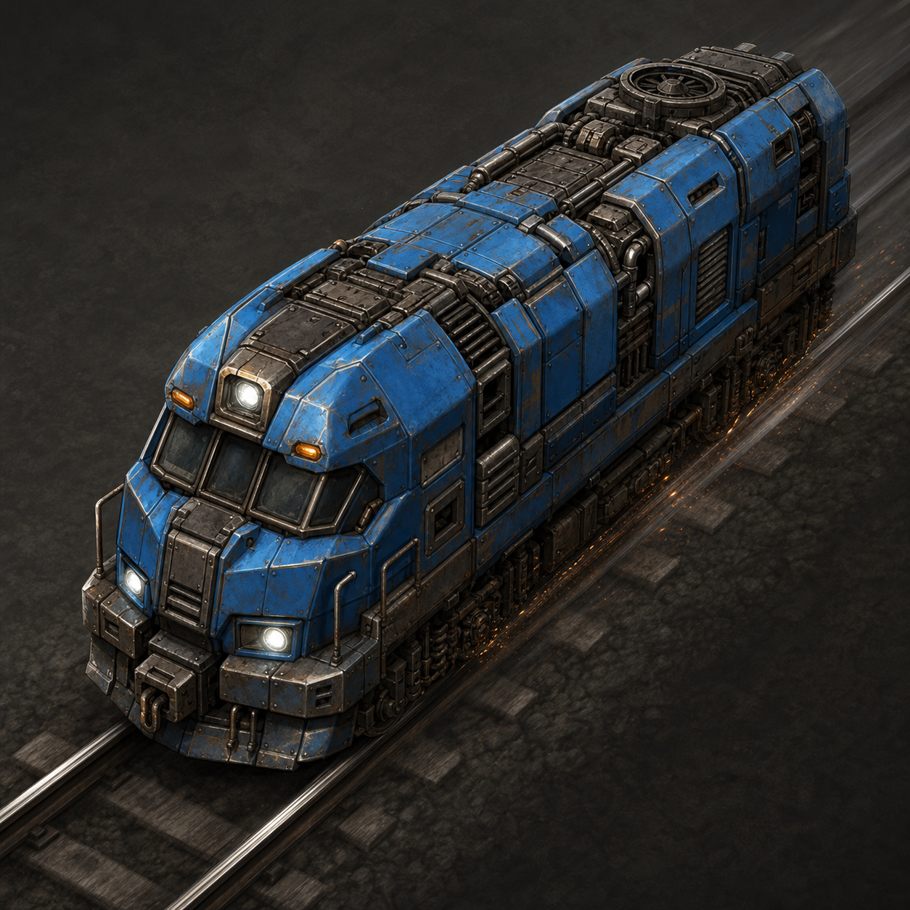

# HighSpeedTrain

Adds high-speed locomotives and matching wagons for fast rail networks: four
locomotive tiers, cargo wagons in three tiers (Mk3 holds 200 slots) and fluid
wagons in three tiers (Mk3 holds 222,000), and artillery wagons in two tiers —
the Mk2 fires 25 % faster and the mod's Mk2 shell does twice the blast damage of
a vanilla one. Everything is a modified copy of the vanilla counterpart, so the
wagons behave like the ones you already know.

Current version: 1.4.0, targeting Factorio 2.1 (`factorio_version` in
`info.json`). All numbers below are read back from the game's own data dump
(Factorio 2.1.23), not from memory.



## Locomotives

`max_speed` is the prototype value; a train drives at the `max_speed` of its
fastest locomotive. The vanilla 2.1 locomotive sits at 1.2, which is what the
"vs vanilla" column compares against.

| Entity | `max_speed` | vs vanilla (1.2) | `max_power` | `braking_force` | weight | health |
|---|---|---|---|---|---|---|
| High-Speed Locomotive | 4 | ≈3.3× | 4000 kW | 90 | 1000 | 800 |
| High-Speed Locomotive Mk2 | 5 | ≈4.2× | 5000 kW | 110 | 1000 | 800 |
| High-Speed Locomotive Mk3 | 7 | ≈5.8× | 7000 kW | 130 | 1000 | 800 |
| High-Speed Locomotive Mk4 | 50 | ≈42× | 7000 kW | 250 | 1000 | 800 |

For reference, vanilla: `max_speed` 1.2, 600 kW, braking force 10, weight 2000,
health 1000. The high-speed locos are lighter, stronger-powered and brake far
harder, but are slightly less tough. The Mk4 value is the 100 % reference: the
`highspeedtrain-mk4-speed-percent` startup setting scales it down — see
"Startup settings".

## Wagons

| Entity | Capacity / inventory | `braking_force` | weight | health |
|---|---|---|---|---|
| High-Speed Cargo Wagon | 100 slots (vanilla: 40) | 50 | 1000 | 800 |
| High-Speed Cargo Wagon Mk2 | 100 slots (vanilla: 40) | 250 | 1000 | 800 |
| High-Speed Cargo Wagon Mk3 | 200 slots (vanilla: 40) | 250 | 1000 | 800 |
| High-Speed Fluid Wagon | 111,000 (vanilla: 50,000) | 50 | 2500 | 800 |
| High-Speed Fluid Wagon Mk2 | 111,000 (vanilla: 50,000) | 250 | 2500 | 800 |
| High-Speed Fluid Wagon Mk3 | 222,000 (vanilla: 50,000) | 250 | 2500 | 800 |
| High-Speed Artillery Wagon | vanilla gun (`cooldown` 200, `range` 224) | 50 | 4000 | 1000 |
| High-Speed Artillery Wagon Mk2 | own gun, `cooldown` 150 → 25 % faster, `range` 224 | 250 | 4000 | 1000 |

Wagon capacity and inventory use the live 2.1 fields (`capacity`,
`inventory_size`). Wagons do not carry a speed value any more — see
"Factorio 2.1 notes".

## Artillery: which fields 2.1 really leaves you

The numbers above come from dumping `data.raw`, not from wiki memory, and they
decided what an "Mk2 artillery wagon" can honestly mean:

- **The wagon has no shooting stats of its own.** In 2.1 there is no
  `attack_parameters`, `range` or `reload` on `artillery-wagon` at all. What the
  entity does carry is `gun` (the *name* of the gun prototype that does the
  shooting), plus `turret_rotation_speed` 0.001, `turn_after_shooting_cooldown`
  60, `manual_range_modifier` 2.5, `ammo_stack_limit` 100 and `inventory_size` 1.
- **So Mk2 upgrades the gun prototype.** The vanilla `gun` prototype
  `artillery-wagon-cannon` carries `attack_parameters.cooldown` 200 (ticks
  between shots; the vanilla gun census spans 1–200), `range` 224 and
  `min_range` 32, and base itself researches that exact axis — the technology
  `artillery-shell-speed-1` has effect type `gun-speed` on ammo category
  `artillery-shell`. The Mk2 wagon points at its own copy of that gun with
  `cooldown` 150. `range`/`min_range` stay untouched: base runs a separate
  `artillery-shell-range-1` line (`artillery-range` effect) for that. The three
  aiming fields above are deliberately untouched too, because the dump shows
  wagon *and* `artillery-turret` carrying identical values — there is no other
  vanilla value to raise them to, and inventing one would be a dead field.
- **Damage lives on the shell's projectile, not on the ammo item.** No ammo
  prototype in the dump has a `damage` field. The blast is in the
  `artillery-projectile` prototype: two damage nodes at radius 4 — 1000 physical
  plus 1000 explosion. The mod's `highspeed-artillery-shell-mk2` points its
  `ammo_type` at a copy of that projectile with **2000 + 2000**, twice the
  vanilla dump values. `ammo_category` stays `artillery-shell`, so every
  artillery wagon (vanilla, Mk1 and Mk2) can load either shell, and base's own
  damage/fire-rate research lines keep working on both.
- **Quality.** `quality_affects_*` exists exactly three times in the whole dump
  (`locomotive`→max_speed, `cargo-wagon`→inventory_size, `fluid-wagon`→capacity).
  `artillery-wagon`, `gun` and `ammo` prototypes have none, so the Mk2 artillery
  copies set none either — a made-up flag would be ignored silently.

The Mk2 shell recipe is derived from the vanilla shell recipe only
(`radar` 1, `calcite` 1, `tungsten-plate` 4, `explosives` 8, 15 s): the charge is
what doubles, so `explosives` goes 8 → 16 and `energy_required` 15 → 30, while
fuze, calcite and the tungsten casing stay as they are.

## Startup settings

All three are startup settings: set them when you create the map. The slider is
verified against the game's data dump at 100 % and at 40 %; the two switches
were verified in their own data-stage runs. The shipped migration
(`migrations/1.2.0.lua`) resets recipes and technologies on existing saves, so
unlock state lines up again after an update.

| Setting (internal name) | Default | Effect |
|---|---|---|
| High-speed trains do not need fuel (`highspeedtrain-no-fuel`) | off | All four high-speed locomotives get a `void` energy source and run without fuel. Vanilla locomotives are untouched. |
| Free recipes and instant unlocks (`highspeedtrain-free-mode`) | off | All thirteen HighSpeedTrain recipes become ingredient-free and are enabled right away; the twelve technologies are hidden, lose prerequisites and unlock effects, and shrink to a single automation pack in 1 s. |
| Highspeed Mk4-Tempo-Prozent (`highspeedtrain-mk4-speed-percent`) | 100 % | Scales only the Mk4 locomotive's `max_speed`, to 20–100 % of the 50 reference value (40 % → 20, 20 % → 10). `max_power`, braking force and weight are untouched, and the Mk1–Mk3 ramp (4/5/7) keeps its shape. Purpose: the Mk4 outlier at the top of the ramp can be dialled back deliberately instead of being hard-coded. |

## Research and crafting (default mode)

Technology tree — the technologies are named after the tier, the recipes after the
entity, so `highspeedtrain` unlocks the `highspeed-locomotive` recipe. Each
technology carries its own icon: the vehicle it unlocks, tinted in that tier's
colour, so the tiers are easy to tell apart in the research tree:

```
braking-force-2 ─► highspeedtrain ─┬─► highspeedtrainmk2 ─► highspeedtrainmk3 ─► highspeedtrainmk4
                                   ├─► highspeedcargo ─► highspeedcargomk2 ─► highspeedcargomk3
                                   │                                              (also needs vanilla "speed-module-3")
                                   ├─► highspeedfluid ─► highspeedfluidmk2 ─► highspeedfluidmk3
                                   │                                              (also needs vanilla "speed-module-3")
                                   └─► highspeedartillery ─► highspeedartillerymk2
                                          (also needs vanilla "artillery")    (also needs vanilla "artillery-shell-speed-1")
```

Recipes are built from vanilla parts, and each tier consumes the previous one:

| Recipe | Ingredients |
|---|---|
| High-Speed Locomotive | 1 locomotive, 20 processing units, 10 speed modules |
| High-Speed Locomotive Mk2 | 1 High-Speed Locomotive, 20 processing units, 10 speed modules 2 |
| High-Speed Locomotive Mk3 | 1 Mk2 loco, 20 processing units, 10 speed modules 2 |
| High-Speed Locomotive Mk4 | 3 Mk3 locos, 250 processing units, 10 speed modules 3 |
| High-Speed Cargo Wagon | 3 cargo wagons, 20 processing units, 10 speed modules |
| High-Speed Cargo Wagon Mk2 | 5 High-Speed Cargo Wagons, 250 processing units, 10 speed modules |
| High-Speed Cargo Wagon Mk3 | 4 High-Speed Cargo Wagon Mk2s, 500 processing units, 10 speed modules 3 |
| High-Speed Fluid Wagon | 3 fluid wagons, 20 processing units, 10 speed modules, 100 lubricant |
| High-Speed Fluid Wagon Mk2 | 5 High-Speed Fluid Wagons, 250 processing units, 10 speed modules, 100 lubricant |
| High-Speed Fluid Wagon Mk3 | 4 High-Speed Fluid Wagon Mk2s, 500 processing units, 10 speed modules 3, 100 lubricant |
| High-Speed Artillery Wagon | 1 artillery wagon, 40 processing units, 20 electric engine units, 10 speed modules 2 |
| High-Speed Artillery Wagon Mk2 | 1 High-Speed Artillery Wagon, 80 processing units, 40 electric engine units, 10 speed modules 2 |
| High-Speed Artillery Shell Mk2 | 1 radar, 1 calcite, 4 tungsten plates, 16 explosives (vanilla shell: 8), 30 s |

The three fluid wagon recipes are `crafting-with-fluid` (as in 2.1). Research
costs follow the tier: the top-tier technologies (`highspeedtrainmk4`,
`highspeedcargomk2`, `highspeedfluidmk2`) ask for 200 packs of all seven
science types, and the two Mk3 technologies (`highspeedcargomk3` and
`highspeedfluidmk3`) sit one step above them at 250 packs of all seven — 25
packs per unit instead of 20, so 25 % above their Mk2 in count and per unit
alike, and each also requires vanilla `speed-module-3` as a prerequisite. The artillery
Mk2 (`highspeedartillerymk2`) scales the `highspeedartillery` pattern by the same
25 %: 313 iterations of 3 packs each (from 250 × 2; 250 × 1.25 = 312.5 and
2 × 1.25 = 2.5, and both are rounded up because 2.1 has no half lab pack), still
on the six science types of its Mk1, still 45 s per iteration. Its second
prerequisite is vanilla `artillery-shell-speed-1`, the research line that speeds
up the very gun the Mk2 replaces. Three recipes are the only ones in the mod that
raise `energy_required` above the inherited value: the two Mk3 wagon recipes (1 s
cargo, 1.5 s fluid → 10 s: four Mk2 wagons plus 500 processing units should take a
visible amount of assembly time) and the Mk2 shell recipe (15 s → 30 s for the
double charge).
The cargo Mk3 holds 200 slots — double the Mk2's 100, five times vanilla's 40 —
and the fluid Mk3 holds `capacity` 222,000, exactly double the 111,000 of Mk1
and Mk2 and 4.44 times vanilla's 50,000; both scale with quality like their
Mk2 counterparts.

## Mk4: intentionally extreme

The Mk4 sits at `max_speed` 50 — about 42 times the vanilla locomotive, and
roughly 7 times the Mk3. That is on purpose: it is an endgame, "because I can"
locomotive, priced accordingly (3 Mk3 locos, 250 processing units, 10 speed
modules 3, plus 200 packs of every science type). Its braking force of 250 is
the highest of the four, but it grows far less than the speed does: 2.8 times the
Mk1's braking force for 12.5 times its speed. Stopping therefore takes far more
track than with the lower tiers, so the Mk4 belongs on long, dedicated,
well-blocked mainlines. If you want a fast network that still behaves sanely,
stop at Mk3.

## Train assistant: warning for mixed locomotive tiers

The mod is mostly a data mod, but it ships a small `control.lua` that does
nothing per tick — it hooks only three things:

- **Mixed tiers in one train.** When a train is created with two or more
  different HighSpeedTrain locomotive tiers (for example Mk1 + Mk3), a short
  German chat warning names the tiers and the position of the train. The point:
  a train drives at the `max_speed` of its fastest locomotive while braking
  force and acceleration are mixed, so such a consist is hard to schedule. A
  train on a single tier, or on vanilla locomotives, stays quiet. Factorio fires
  `on_train_created` again whenever rolling stock is added or removed, so the
  warning can repeat for the same train.
- **`/hst-info`** answers with the mod version and the HighSpeedTrain locomotive
  and wagon types seen on this map, counted at train creation, plus a hint that
  trains which existed before the mod was installed only show up once they are
  re-created. It answers both through `game.print` and as the command result, so
  it also works from a server console or over RCON.
- **Version stamp:** `on_init` and `on_configuration_changed` write
  `storage.hst_version`. The version lives as a literal in `control.lua` (a
  packed mod's `info.json` is not reliably readable in the control stage), so it
  has to be bumped together with `info.json` on release.

The control-stage strings are plain German literals, not locale keys: `locale/en`
and `locale/de` still cover only the data stage (entities, items, recipes,
technologies, settings).

Three 2.1 API details are pinned by comments in `control.lua`, because they are
all different from the pre-2.0 names: the event is
`defines.events.on_train_created` (the un-prefixed name is nil in 2.x and
`script.on_event` then dies at load), the wagon list is `train.carriages`
(`cars` raises), and `LuaTrain` has no `name` field any more — which is why the
warning points at the train's position instead of its name.

## Factorio 2.1 notes

- **Train speed comes from locomotives only.** In 2.1 no wagon prototype has a
  `max_speed` field — not the vanilla wagons, and not this mod's wagons
  (confirmed by dumping `data.raw`). A train's top speed is the highest
  `max_speed` among its locomotives. Weight and braking force of wagons still
  matter for acceleration and stopping, which is why the Mk2 wagons are mostly
  about braking force (250 instead of 50), not about speed.
- **Fluid wagon capacity** is set through the 2.1 field `capacity`. The pre-2.1
  names `total_capacity` and `pumping_speed` are not part of the 2.1 fluid-wagon
  prototype at all (they appear nowhere in the data dump), so they are not used
  here.
- **Quality.** In 2.1, whether a quality tier scales a stat is decided per
  prototype by flags like `quality_affects_max_speed`,
  `quality_affects_inventory_size` and `quality_affects_capacity`. Base sets
  those to `true` for its own prototypes in a data phase that runs *after* this
  mod's copy step (`Loading mod HighSpeedTrain (data.lua)` precedes
  `Loading mod base (data-updates.lua)`), so this mod sets the flags itself.
  A quality tier scales HighSpeedTrain locomotive speed, cargo-wagon inventory
  and fluid-wagon capacity just like it does for the matching vanilla wagon;
  the artillery wagon carries no such flag because the vanilla artillery wagon
  has none either, and neither has any `gun` or `ammo` prototype in the dump —
  the Mk2 artillery copies therefore set no quality flag at all.
- **Recipes** use the merged 2.1 `categories` field; the pre-2.0
  `category`/`additional_categories` pair is rejected by the loader.

## Testing and contributing

```sh
luacheck .
```

```sh
FACTORIO_BIN="$HOME/Library/Application Support/Steam/steamapps/common/Factorio/factorio.app/Contents/MacOS/factorio" \
  ./scripts/smoke-test.sh
```

`scripts/smoke-test.sh` runs four steps: check `info.json`, lint Lua syntax, pack
the current checkout into a temporary mods directory, then load that pack twice
in an isolated, throw-away Factorio. Step 3 is the data stage (`--dump-data` on a
GUI client such as the Steam build, `--create` on a headless build) and step 4 is
the control stage (`--create`, which loads `control.lua`, registers the event
handlers and commands, and runs migrations). The runtime stage fails on a
non-zero exit, on error signatures in the log **or** on stdout, and when the
mod's `control.lua` never shows up in the load sequence — it is the step that
catches Lua which compiles but dies at load, such as a renamed 2.x event or a
renamed API field. Each Factorio stage writes into its own directory, so neither
stage can hide the other's log, and a binary that cannot do `--create` says so
loudly instead of passing silently. Without `FACTORIO_BIN` the script downloads
the current stable headless tarball anonymously, which is what CI does. The
smoke-test workflow (`.github/workflows/smoke-test.yml`) runs `luacheck .` and
the smoke test on pushes to `main` and `dev`, on pull requests and manually;
releases to the Mod Portal happen from `main` via `.github/workflows/release.yml`
(semantic-release), so please send PRs against `dev` and use
conventional-commit messages (`feat:`, `fix:`, `chore:` …). One consequence of
that pipeline: `changelog.txt` is *written by the release*, not by hand —
`semantic-release-factorio` prepends the generated Factorio-format block
(`Version:` / `Date:` / grouped commit subjects, see `writerOpts` in
`.releaserc`) to the existing file and `@semantic-release/git` commits it
together with the bumped `info.json`. Hand-writing an entry for an unreleased
version would leave two `Version: x` blocks once that version ships.

### Save upgrade check (1.4.0 → 1.5.0)

The upgrade path was driven through an isolated Factorio rather than reasoned
about: a map created and filled while only the released 1.4.0 pack was
installed (all nine technologies of that version researched without any
`reset_technologies` call, four HighSpeedTrain items on the ground, fluid wagon
`fluid_capacity` 50 000, no Mk3 prototype) was then loaded with the current
development pack, versioned 1.5.0 — the version `semantic-release` will write.
Exit code 0, no `Error`/`Warning` line in the game log, no `Applying migration:`
line. In that old force afterwards: the nine researched technologies are still
researched and the old recipes still enabled, while the three new technologies
(`highspeedcargomk3`, `highspeedfluidmk3`, `highspeedartillerymk2`) and their
recipes are present but unresearched/locked — Factorio 2.1 adds new mod
technologies to existing forces on its own, and the old migration files stay
skipped because they carry versions below the saved one. New content is live
(`highspeed-fluid-wagonMK3`, `highspeed-cargo-wagonMK3`,
`highspeed-artillery-wagonMK2`, the Mk2 shell) and the capacity fix shows up in
the loaded save (111 000, Mk3 222 000). So no `migrations/1.5.0.lua` is needed
and none was invented; whether migrations would run at all was proven with a
throw-away probe file in the test pack, which did log
`Applying migration: HighSpeedTrain: …`. The released 1.4.0 declares
`factorio_version: 2.0`, so the *test* copy of that pack additionally carried
the two 2.1-only compat bits that `main` already has (`category` →
`categories` in the fluid recipes, `factorio_version: 2.1`); no repository file
was touched for that.

Localization lives in `locale/en` and `locale/de` — translations of the entity,
technology and setting strings are easy wins. Issues and pull requests on
GitHub: <https://github.com/J3n50m4t/HighSpeedTrain>.

Authors: J3n50m4t and Ostrei.
